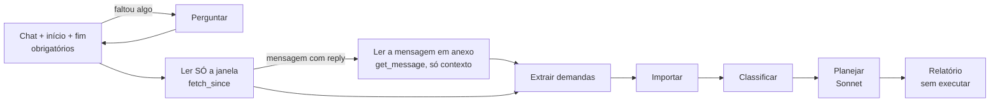

# /telegram-tarefa — detalhamento

Comando: [telegram-tarefa.md](../../../commands/telegram-tarefa.md). Escopo: **por domínio** (tarefas). Este doc guarda o algoritmo e os formatos; o comando guarda só o fluxo operacional.

## 1. Visão



## 2. Janela de tempo (obrigatória)

| Situação | Ação |
|---|---|
| Falta o chat | Sugerir os chats ativos (ver abaixo) e perguntar **qual** |
| Falta o **início** inteiro | Perguntar |
| Falta o **fim** inteiro | **Não perguntar:** ler do início em diante, até agora (decisão do usuário, 17/11/2026) |
| "tudo", "últimas N", "recentes" | Recusar o atalho e pedir início/fim explícitos |
| Ano omitido | Ano corrente |
| Mês omitido | Mês corrente |
| Dia omitido | Dia corrente |
| Hora omitida (só data) | Hora/minuto correntes (agora) |
| **Só dias**, sem hora ("dias 17 e 18", "dia 17", "17 a 19") | **Dias inteiros** (decisão do usuário, 18/11/2026): início 00:00 do 1º dia; fim 23:59:59 do último, ou **agora** se esse dia for hoje/futuro. Prevalece sobre "hora omitida = agora" |
| Fim informado ≤ início, ou fim no futuro | Perguntar de novo |

### Sugestão de chat quando não informado

- `list_dialogs(limit ≈ 15)`: devolve `Tipo: Nome [id:…]` já **ordenado por atividade recente**, com `(N unread)` quando há não lidas. Não traz data nem mensagens.
- "Ativos" = os ~10 primeiros dessa ordem. Mostrar nome, tipo (Chat/Channel/User), não lidas e id.
- Perguntar com `AskUserQuestion`: as 4 primeiras opções = os 4 chats mais acima (o limite da ferramenta é 4 opções); o restante da lista vai no texto da pergunta; "Outro" cobre qualquer chat. O usuário pode responder também por nome ou id.
- Chats pessoais (`User:`) e canais sem relação com trabalho aparecem como qualquer outro: **só sugerir, nunca escolher**, e não ler mensagem alguma antes da resposta.
- Se o chat informado como nome casar com mais de um diálogo, listar os candidatos e perguntar.

Os componentes corrente valem **só dentro** de um início/fim informado (decisão do usuário, 17/11/2026). Exemplos, supondo agora = 17/11/2026 14:20:

| Digitado | Interpretado |
|---|---|
| `08:00` | 2026-11-17 08:00 |
| `05 08:00` | 2026-11-05 08:00 |
| `05/11` | 2026-11-05 14:20 |
| `05/11 08:30` | 2026-11-05 08:30 |
| `dias 17 e 18` (agora = 18/11 09:55) | 2026-11-17 00:00 até 2026-11-18 09:55 |
| `dia 12` | 2026-11-12 00:00 até 2026-11-12 23:59:59 |

Sempre repetir a janela **já preenchida** antes de ler, para o usuário pegar um preenchimento que não era o pretendido.

**Fuso — o MCP devolve UTC, não o horário local.** Confirmado em 17/11/2026: relógio local 15:00 (-03) e mensagens do mesmo dia já marcadas 17:36; a mensagem "Bom dia" do Sérgio (digitada às 09:47 locais) veio como `12:47:30`. O usuário fala em **horário local** (`date` da máquina, hoje -03:00).

1. Ler o relógio com `date "+%Y-%m-%d %H:%M:%S %z"` para saber "agora" e o offset.
2. Converter início e fim **do local para UTC** (local − offset) antes de comparar com o timestamp das mensagens.
3. No relatório, mostrar o horário **local** (converter de volta) e deixar o UTC entre parênteses se ajudar.

Nunca comparar o horário digitado pelo usuário direto com o `[AAAA-MM-DD hh:mm:ss]` do MCP.

## 3. Algoritmo de leitura sem varrer o chat

O MCP `telegram` **não tem filtro por data**: `read_messages` devolve as N mais recentes e `fetch_since` pagina por id. Como os ids crescem com o tempo, a janela é achada por id.

1. **Chat:** link/`@`/id direto; nome → `list_dialogs` e confirmar qual é, se houver mais de um candidato. Chat não informado → perguntar qual.
2. **Id máximo:** `read_messages` com `limit 1` (referência do topo).
3. **Primeiro id ≥ início** — sondagem binária entre `0` e o id máximo usando `fetch_since(sinceId = palpite, limit 1, oldestFirst = true)`. Ela devolve a primeira mensagem existente depois do palpite (pula ids apagados) e seu timestamp. Convergir até achar a última mensagem com timestamp < início; o `sinceId` da paginação é o id dela. Cerca de 15–20 chamadas de 1 mensagem.
4. **Paginar:** `fetch_since(sinceId, limit 200, oldestFirst = true)`, repetindo com o maior id recebido. **Parar** na primeira mensagem com timestamp > fim, ou quando não vier mais nada.
5. **Filtrar** por `início ≤ timestamp ≤ fim` antes de qualquer resumo. As mensagens-sonda fora da janela só servem para achar o id e **não são analisadas nem listadas**.
6. **Serviço:** `[no text]` sem mídia (entrada/saída de membro, "Incluso financeiro") = ruído; ignorar.
7. **Volume:** > ~500 mensagens na janela → informar a contagem e confirmar.

Ver o aprendizado que originou a regra: memória `feedback_telegram_respeitar_periodo_e_ignorar_servico` (parar no fim da janela; mensagens de serviço não são pedidos).

### 3.1 Mensagem em anexo (resposta) — contexto fora da janela

Decisão do usuário (18/11/2026): ao ler uma mensagem, **se ela traz outra mensagem em anexo, ler essa mensagem também** para entender melhor o pedido.

- **O que é "em anexo":** a mensagem respondida. O MCP marca no fim da linha da mensagem que responde: `... [reply:ID]` (é o único vínculo explícito que o Telegram dá entre duas mensagens). `get_message(chat, ID)` traz a mensagem referenciada. O MCP **não expõe** encaminhamento: o texto encaminhado já vem no corpo da própria mensagem.
- **Como:** para cada mensagem **dentro da janela** com `[reply:ID]`, ler o `ID`. Se ele já estiver entre as mensagens lidas da janela, reaproveitar (sem chamada nova); senão `get_message`. Se a referenciada também tiver `[reply:ID]`, seguir a cadeia, **no máximo 3 níveis**. Mensagem apagada ou não encontrada (`(message N not found)`): registrar no relatório e seguir.
- **Pode estar fora da janela.** Esta é a **única exceção** à regra de ferro "nada fora da janela". Limites: só a mensagem referenciada e a cadeia dela, **nunca as vizinhas**; a janela não aumenta; essas mensagens **não entram na contagem** de mensagens da janela nem na regra das ~500; **não geram demanda por si** (o pedido é a mensagem da janela; a anexa só explica o "feito?", "isso mesmo", "ajusta aquilo").
- **Mensagem de serviço** (`[no text]` sem mídia) em anexo: ignorar.
- **Fuso:** o timestamp da mensagem em anexo também vem em UTC; mostrar em horário local, como as demais.
- **Registro:** vai para a demanda como **contexto**, separada do pedido (ver §6), e entra no relatório (§7) com id, data/hora, autor e a mensagem da janela que a citou.

## 4. Mídia

Só de mensagens **dentro** da janela **e das mensagens em anexo (§3.1)**, e só se necessária: `get_media_info` para ver o tipo → `download_media` → imagem lida direto; PDF via OCR (`pdf_ocr/pdf_ocr.py` em `ai-tools`, como no `/importar-tarefa`). Anexos baixados vão para a pasta da demanda.

## 5. Extração de demandas

- **É demanda:** pedido de alteração, correção, relatório, tela, ajuste de regra, dúvida que exige mudança.
- **Não é demanda:** conversa, agradecimento, confirmação, status, mensagem de serviço.
- **Usar o contexto:** a mensagem em anexo (§3.1) serve para entender o que a mensagem da janela pede; sem ela, "feito?" ou "pode seguir" não diz nada.
- **Agrupar** mensagens que respondem entre si, do mesmo autor em sequência, ou sobre o mesmo assunto/card. Um pedido que mudou de ideia no meio da conversa vale pela **versão final**, registrando a evolução em `consideracoes.md`.
- **Ambíguo** (duas demandas ou uma? é pedido ou comentário?) → perguntar ao usuário.
- **Projeto alvo:** inferir pelo conteúdo (ApiDPC, DPC, Faisao, DpcInventario, ApiNFE); sem confiança → perguntar, como o `/importar-tarefa` já faz.

## 6. Pasta de cada demanda

Segue [tarefas.md](tarefas.md). Além dos arquivos mínimos, `conteudo-da-tarefa.md` traz as mensagens-fonte literais — e, numa seção separada **"Contexto (mensagem respondida)"**, as mensagens em anexo (§3.1), com id, data/hora e autor, para não serem confundidas com o pedido — e `metadata.json` guarda a origem:

```json
{
  "origem": "telegram",
  "chat": "<nome/id>",
  "janela": { "inicio": "AAAA-MM-DD hh:mm", "fim": "AAAA-MM-DD hh:mm" },
  "mensagens": [{ "id": 0, "datahora": "AAAA-MM-DD hh:mm:ss", "autor": "" }],
  "contexto": [{ "id": 0, "datahora": "AAAA-MM-DD hh:mm:ss", "autor": "", "respondida_por": 0, "foraDaJanela": true }]
}
```

## 7. Relatório final

1. Janela lida e total de mensagens (dentro da janela / de serviço ignoradas).
2. Tabela: título · autor · projeto · complexidade · modelo do planejamento · pasta.
3. Mensagens ignoradas, com id e trecho — para o usuário apontar se algo era pedido.
4. **Mensagens em anexo lidas** (§3.1): id · data/hora local · autor · a qual mensagem da janela respondem · se estão fora da janela; e as que não foram encontradas.
5. Demandas que falharam na importação/planejamento e o motivo.
6. Dúvidas em aberto.
7. Próximo passo: revisar cada `planejamento.md` → `/executar-tarefa`.

## 8. Limites

Não altera código, não cria branch, não commita, não faz push/PR, não responde no Telegram. A execução é sempre uma decisão posterior do usuário. Só lê mensagem fora da janela no caso da **mensagem em anexo** (§3.1), e só ela.
